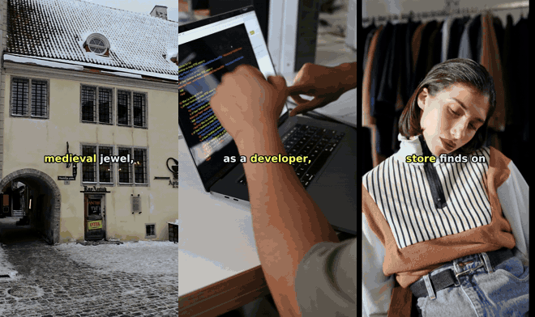
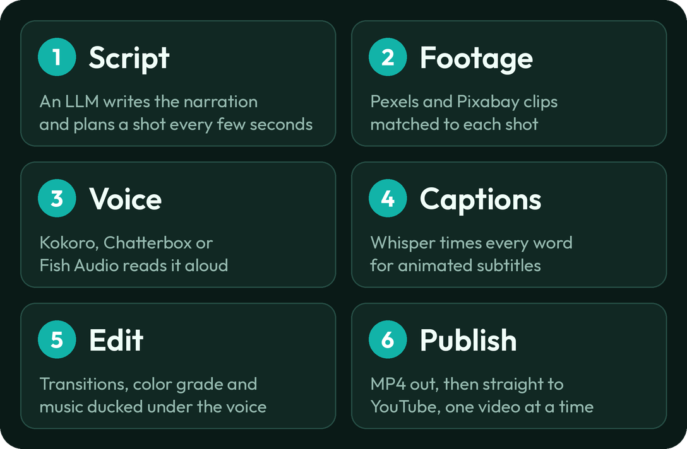

<p align="center">
  <picture>
    <source media="(prefers-color-scheme: dark)" srcset="docs/brand/wordmark-dark.png">
    
  </picture>
</p>

<p align="center">
  <b>Type a topic, get back a narrated, captioned Short built from free stock footage, on your own machine.</b><br>
  Queue a whole week of videos and let it publish them to YouTube one by one.
</p>

<p align="center">
  <a href="LICENSE.md"></a>
  
  
  <a href="https://github.com/WaelHoury/reelmint/actions/workflows/ci.yml"></a>
</p>

<p align="center">
  
</p>

Reelmint writes the script, finds matching clips on Pexels and Pixabay, records a voiceover, times captions to each spoken word, adds music and a color grade, and renders an MP4. You can review the script and every clip before it renders, and fix anything in a timeline editor afterward.

It runs locally. With Ollama and Kokoro you need one free account (Pexels) and no paid APIs. You can also have Claude, or any model on OpenRouter, write the scripts.

## Made with it

Every video on **[@OddSensei0](https://www.youtube.com/@OddSensei0)** was made with this tool, without manual editing.

<p align="center">
  <a href="https://www.youtube.com/shorts/84hl5XBN6l8"></a>
  <a href="https://www.youtube.com/shorts/eByDbQQvEag"></a>
  <a href="https://www.youtube.com/shorts/6cgEXoYGOUY"></a>
  <a href="https://www.youtube.com/shorts/N73o3l_6-jQ"></a>
</p>

<p align="center"><sub>Is duck seafood? · Is a river a "thing"? · Is ketchup a smoothie? · Is cereal soup? (<a href="examples/is-cereal-soup.txt">script</a>)</sub></p>

Long-form works too: [The Present is a Lie](https://www.youtube.com/watch?v=QpQJrh9whdY) (16:9).

## How it works

<p align="center">
  
</p>

Each step is swappable: Ollama, OpenRouter or Claude for the script; Pexels and Pixabay for footage, with a slow zoom on stills when no video fits; Kokoro, Chatterbox or Fish Audio for the voice. Output is 9:16, 16:9 or 1:1, plus a credits file for every clip used.

What's different from other "money printer" style generators:

- **You approve before it renders.** The web app stops after the script and again after clip selection. Swap any clip by searching for a better one, then render.
- **An editor after the render.** Re-time clips, restyle captions (font, color, outline, position) and re-render without starting over.
- **Shots follow the narration.** The planner writes a visual description for every few seconds of speech, not one keyword per scene. The CLI also downloads several candidates per shot and keeps the one [OpenCLIP](https://github.com/mlfoundations/open_clip) rates closest to that description.
- **Credits are tracked.** Every render writes `<name>_credits.txt` with the author and link for each clip, ready to paste into a description.

## Autopilot: run a channel from a list of topics

Paste ten topics (one per line), paste ten finished scripts, or just name a niche ("weird food facts") and let the AI suggest fresh topics that don't repeat your earlier videos. Then press start. Reelmint makes the videos one at a time, in order. As each one finishes, it can go straight to YouTube with an AI-written title, description and tags, and the footage credits are added to the description for you.

- **Publish now or on a schedule.** "First at 9:00, then every 4 hours" uses YouTube's own scheduled publishing, so videos go live on time even if your computer is off.
- **Hands-off mode, safe to leave overnight.** Failed steps retry on their own (up to three tries, with a pause between), and if YouTube's daily upload quota runs out, uploads wait for the reset and continue. Nothing stops to ask you.
- **Without hands-off,** a failed video is marked with the reason and the batch moves on; retry it with one click. Pause, resume or add more topics at any time.
- **No repeated shots.** A clip never appears twice in the same video. When the best match is taken, the search widens step by step (more results, fewer keywords, nouns from the shot description, the topic, Pixabay) until it finds a fresh one.
- **Same pipeline as one-off videos.** Same voices, caption styles and formats, and every video lands in your library where you can open it in the editor.

Hosted "faceless channel" tools usually sell this as a paid monthly plan with a cap on how many videos you can make. Here it runs on your own machine, with no per-video fees.

Two YouTube rules to know before you automate:

- **Uploads stay private until your Google Cloud project passes YouTube's [API compliance audit](https://developers.google.com/youtube/v3/guides/quota_and_compliance_audits).** Apply once for the project whose OAuth client you use in Reelmint. Until then, use Autopilot to upload as private and publish from YouTube Studio.
- **Uploads per day are limited by your project's API quota.** Check the YouTube Data API v3 quota in the Google Cloud Console and request more if you plan to post often.

From the command line (no web app, no publishing), the same idea is `--batch`:

```bash
python generate_video.py --batch examples/batch-topics.txt --duration 0.75 \
  --orientation portrait --output videos/
```

## Quick start

You need a free [Pexels API key](https://www.pexels.com/api/), plus something to write scripts: [Ollama](https://ollama.com) (local and free), a Claude subscription, an Anthropic API key, or an OpenRouter key.

### Web app (Docker)

```bash
git clone https://github.com/WaelHoury/reelmint.git
cd reelmint
cp .env.example .env          # paste your PEXELS_API_KEY
ollama pull qwen2.5:3b        # skip if you use Claude or OpenRouter
docker compose up --build
```

Open **http://localhost:3000**. Postgres, Redis, the API, two render workers and the frontend all start together, and database migrations run on first boot. There's no sign-up: it's your machine, so it's your account.

### Command line (no Docker)

```bash
python -m venv venv && source venv/bin/activate
pip install -r requirements.txt
python -m spacy download en_core_web_sm     # used by the Kokoro voice
cp .env.example .env                        # paste your PEXELS_API_KEY

# from a topic
python generate_video.py --prompt "why octopuses have three hearts" \
  --duration 1 --orientation portrait --output octopus.mp4

# from your own script, used word for word
python generate_video.py --script examples/is-cereal-soup.txt \
  --orientation portrait --output soup.mp4
```

FFmpeg needs to be on your `PATH` (`brew install ffmpeg`, `sudo apt install ffmpeg`, or `winget install ffmpeg`). Run `python scripts/check_setup.py` to see what's missing.

## Use Claude to write the scripts

Set `LLM_PROVIDER` in `.env`:

| `LLM_PROVIDER` | What it uses | You need |
|---|---|---|
| `ollama` (default) | A local model through Ollama | `ollama pull qwen2.5:3b` (or set `OLLAMA_MODEL`) |
| `claude-code` | Your [Claude Code](https://claude.com/claude-code) CLI, which runs on whatever plan it's logged into (Pro, Max, Team) | Run `claude` once to log in. No API key. Command-line and local installs only, since the CLI isn't inside the Docker image |
| `anthropic` | The Anthropic API | `ANTHROPIC_API_KEY` (defaults to `claude-opus-5-5`) |
| `openrouter` | Any model on [OpenRouter](https://openrouter.ai) | `OPENROUTER_API_KEY` and `OPENROUTER_MODEL` |

Small local models work, but a stronger model writes noticeably better hooks and picks better shots.

## Keys and what they unlock

| Key | Required | Unlocks |
|---|---|---|
| `PEXELS_API_KEY` | **Yes** | Stock video search (free, 200 requests/hour) |
| One LLM option above | **Yes** | Script writing and shot planning |
| `PIXABAY_API_KEY` + `ENABLE_PIXABAY=true` | No | A second footage library, searched alongside Pexels |
| `ENABLE_IMAGE_FALLBACK=true` | No | Uses a Pixabay photo with a slow zoom when no video matches a shot |
| `FISH_AUDIO_API_KEY` | No | Cloud voices and cloning your own voice from a short sample |
| `YOUTUBE_CLIENT_ID` / `SECRET` | No | Publish straight to your YouTube channel from the web app |
| `R2_*` | No | Store renders in Cloudflare R2 instead of local disk |

Every setting is documented in [`.env.example`](.env.example).

## Options

| | |
|---|---|
| **Format** | `portrait` (Shorts, TikTok, Reels), `landscape`, `square`; 30 s up to about 3 min |
| **Narration style** | `viral`, `informative`, `funny`, `storytelling`, `motivational`, `creative` |
| **Captions** | `youtube`, `tiktok` (word-by-word highlight) or `minimal`; font, color, outline and position in the editor |
| **Voices** | Kokoro (about 50 voices across several languages, CPU is fine), Chatterbox (expressive, needs CUDA and `pip install chatterbox-tts`), Fish Audio (cloud) |
| **Look** | Color presets `balanced`, `warm`, `cool`, `vibrant`, `cinematic`, or your own `.cube` LUT; transitions `crossfade`, `dissolve`, `wipe`, `slide` |
| **Music** | Drop royalty-free tracks into `music/<mood>/`; the mood is matched to the topic. See [music/README.md](music/README.md) |
| **Loop mode** | `ENABLE_VIDEO_LOOP=true` makes the ending flow back into the start, for Shorts that replay |

## Hardware

Any recent laptop works. Everything runs on CPU, and an Apple Silicon Mac renders a 60-second Short in a few minutes. An NVIDIA GPU speeds up Whisper and OpenCLIP and is required only for Chatterbox. Expect around 5 GB of disk space for models and caches.

## FAQ

<details>
<summary><b>Can I monetize videos I make with this?</b></summary>

Yes. Videos you make are yours: post them, monetize your channel, sell them to clients. Respect the licenses of the footage and music inside them ([Pexels](https://www.pexels.com/license/), [Pixabay](https://pixabay.com/service/license-summary/)). The credits file next to each render lists every clip.
</details>

<details>
<summary><b>Can I build a paid app or service on this code?</b></summary>

Not without a commercial license. See [License](#license).
</details>

<details>
<summary><b><code>Connection refused</code> to Ollama when using Docker</b></summary>

Ollama runs on your host, not in Docker. Make sure it's running (`ollama serve`) and that `OLLAMA_BASE_URL=http://host.docker.internal:11434` is set for the containers (it is by default in `docker-compose.yml`). On Linux, Ollama must listen on all interfaces: `OLLAMA_HOST=0.0.0.0 ollama serve`.
</details>

<details>
<summary><b>The video has no background music</b></summary>

The repo ships without music, because good free tracks come with their own licenses. Add `.mp3` or `.wav` files to `music/energetic`, `music/calm`, `music/inspiring` or `music/neutral`, or set `ENABLE_BACKGROUND_MUSIC=false`.
</details>

<details>
<summary><b><code>claude-code</code> provider says it's not logged in</b></summary>

Run `claude` in a terminal once and log in. If the CLI isn't on your `PATH`, set `CLAUDE_CODE_PATH` to its full path. When `ANTHROPIC_API_KEY` is set, it's hidden from the CLI so your subscription login is used.
</details>

<details>
<summary><b>A shot doesn't match the narration</b></summary>

In the web app, open the clip step and search for a replacement before rendering, or swap it later in the editor. Enabling Pixabay gives the planner more footage to choose from.
</details>

## Project layout

```
generate_video.py      CLI entry point and the render pipeline
scene_planner.py       script and shot planning (Ollama, OpenRouter, Claude)
claude_llm.py          Anthropic API and Claude Code CLI backends
video_searcher.py      Pexels search; app/media/pixabay_search.py adds Pixabay
tts_generator.py       Kokoro / Chatterbox / Piper voices + Whisper word timing
subtitle_generator.py  animated ASS captions
effects_engine.py      transitions, color grading, overlays
app/                   FastAPI backend, RQ workers, YouTube publishing
frontend/              Vue 3 web app (wizard, editor, library)
```

## License

Reelmint is **source-available** under the [PolyForm Noncommercial License 1.0.0](LICENSE.md), with one addition: **what you make with it is yours to use commercially.**

- **Free:** personal use, hobby channels, research, education, and modifying the code for yourself.
- **Free:** monetizing the videos it produces, including YouTube revenue, sponsorships and client work.
- **Needs a commercial license:** selling the software, offering it (or a fork) as a hosted service, SaaS, API or app, or bundling it into a commercial product.

For a commercial license, [get in touch](https://github.com/WaelHoury). Third-party components keep their own licenses (FFmpeg, Kokoro, OpenCLIP, faster-whisper and others).

## Credits

Stock footage from [Pexels](https://www.pexels.com) and [Pixabay](https://pixabay.com). Built on [FFmpeg](https://ffmpeg.org), [Kokoro](https://github.com/hexgrad/kokoro), [faster-whisper](https://github.com/SYSTRAN/faster-whisper), [OpenCLIP](https://github.com/mlfoundations/open_clip), [Ollama](https://ollama.com), [FastAPI](https://fastapi.tiangolo.com) and [Vue](https://vuejs.org).
